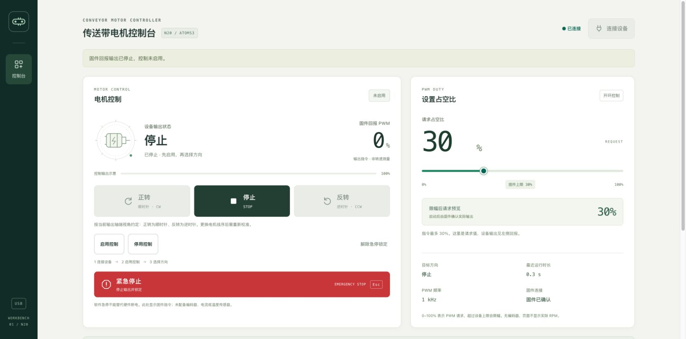

# Conveyor Motor Controller

ATOMS3 Lite（ESP32-S3）+ 双 H 桥模块 + 6V N20 电机的 USB 控制系统。包含可编译固件、可烧录映像、桌面/窄屏网页、串口服务、测试与硬件记录。

- 固件：`conveyor-1.0.0`；网页：`2.0.0`。
- 实物已验证：Mac USB 直连、空载固定，1kHz / 30% PWM；网页正转顺时针、反转逆时针，分别停止。观察视角为正对输出轴端。
- 发布二进制由相同固件源文件重新构建，移除了本机编译路径；**本次公开重编映像未重新刷入实机**。实机结果对应此前烧录的同版本源码。
- 电机为开环 PWM 控制，没有编码器；百分比不是 RPM，不显示虚构电流或温度。



## 项目来源

用于 DIY Google [Conveyor Belt Keyboard](https://github.com/google/mozc-devices/tree/main/mozc-conveyorbelt)，参考[组装指南](https://github.com/google/mozc-devices/blob/main/mozc-conveyorbelt/buildguide_ja.md)。本仓库实现 ESP32-S3 电机控制，未使用 Google 的 CH559 键盘固件，不包含键盘输入功能，不代表 Google 或 M5Stack 官方项目。

## 硬件接线

| ATOMS3 Lite | 驱动模块 | 用途 |
|---|---|---|
| G5 | AIN1 | PWM 输入 1 |
| G6 | AIN2 | PWM 输入 2 |
| 3V3 | 经确认兼容的 SLP / STBY | 使能 |
| GND | GND | 共地 |
| 5V | VM | 本次仅 USB、空载短时试验的供电路径 |
| 模块 AO1 / AO2 | 电机两端 | 极性决定实际方向 |

购买时标作 DRV8833 的实物模块，其使能丝印为 STBY，芯片字样未确认；本仓库不据此保证其具体芯片型号。USB 试验结果不证明持续带载、堵转、电流及温升满足限值。完整引脚视角、条件性 DRV8833 核对和独立供电接法见[接线说明](docs/wiring.md)。烧录/复位前断开电机 VM。

## 使用网页

依赖 Python 3、Chrome 或 Edge。macOS 可双击 `start.command`，或：

```sh
python3 -m venv .venv
.venv/bin/python -m pip install -r tools/requirements.txt
tools/start.sh
```

打开 [http://127.0.0.1:8766](http://127.0.0.1:8766)。选择 USB 直连、连接实际 Espressif 设备，启用控制，再选择正转/反转。停止立即归零；急停锁定后需手动解除并重新启用。Web Serial 不可用时，选择 Python 本机串口服务；两种方式不能同时占用串口。

服务仅监听 Mac 本机。窄屏布局适配不等于已实现手机远程控制；手机远程访问和实际手机 USB 未部署/验收。

## 已验证的工作参数

| 参数 | 实物工作值 | 源码/新烧录默认值 |
|---|---:|---:|
| PWM 频率 | 1000Hz | 20000Hz |
| 默认占空比 | 30% | 20% |
| 最大占空比 | 30% | 30% |
| 换向等待 | 300ms | 300ms |
| 心跳超时 | 1500ms | 1500ms |
| 断开停止 | 开启 | 开启 |

**新设备或清空 NVS 后，先在网页填入并保存 1000Hz / 默认30% / 上限30%，不要假定出厂20kHz能起转。** 参考电机在20kHz / 30%时无动作，在1kHz / 30%时起转；机理未经电气测量确认。参数存 ESP32 NVS，运行/使能状态不保存。

方向映射位于 `web/src/hardware-profile.js`：网页正转发送固件 raw `reverse`，网页反转发送 raw `forward`，状态与目标方向同步映射。这只对应参考接线；更换线序后需现场重新确认。

## 构建与烧录

安装 PlatformIO Core，准备 Python 3、Node.js 和 C++17 编译器。固定 pioarduino 55.03.37 / Arduino ESP32 3.3.7；板配置 ESP32-S3、DIO、8MB 分区。

```sh
.venv/bin/python -m pip install -r tools/requirements-dev.txt
PIO="$PWD/.venv/bin/pio" tools/build.sh
```

`dist/` 含四个映像及 `SHA256SUMS`。所有固件二进制均来自构建，**不含 NVS 或整片设备备份**。烧录工具使用 `PIO_PYTHON` 指定环境中的 esptool；以上开发依赖安装到项目 `.venv`，下面命令显式使用它。先断开电机 VM，再查询实际串口与 USB 序列号，将下面两个占位值替换为你的设备：

```sh
PIO_PYTHON="$PWD/.venv/bin/python" tools/flash.sh --port /dev/cu.usbmodemXXXX --expected-mac YOUR_DEVICE_MAC --confirm-vm-disconnected
.venv/bin/python tools/serial_test.py --port /dev/cu.usbmodemXXXX --confirm-vm-disconnected
```

烧录脚本会核对指定 USB 序列号、ROM ESP32-S3、8MB Flash 及安全状态，先备份整片 Flash，再写入/逐映像验证。不自动清 NVS，不改 eFuse，不绕过安全启动。诊断工具要求显式设备参数；`short_pulse.py` 会真实运行电机，不能当作无运动测试。

## 测试与维护

```sh
tools/test.sh
```

需先完成上述 Python 依赖安装。测试覆盖同源 C++ 安全状态机、JSON 应答、方向校准、网页状态/输入边界和串口服务；它们不替代实物验收。参见[测试矩阵](docs/test-record.md)、[协议](docs/protocol.md)、[网页说明](docs/ui-v2.md)、[起转排查](docs/motor-bringup-20261019.md)、[故障排查](docs/troubleshooting.md)及[第三方来源](THIRD_PARTY.md)。

上电/重启默认停止；换向先停止并等待；上限限幅；急停锁定；断线和心跳超时停止。软件急停不能代替硬件断电。未完成：持续带载、堵转、电压/电流/温升、PWM 波形、实际 RPM、运动时物理断线及完整异常恢复。

## English

USB motor controller for M5Stack ATOMS3 Lite (ESP32-S3), an H-bridge module sold as DRV8833, and a 6V N20 gearmotor. Includes Arduino/PlatformIO firmware, JSON Lines protocol, Web Serial UI, a localhost Python relay, tests and flash images. No keyboard functionality or closed-loop RPM control.

The reference motor was observed rotating clockwise for UI Forward and counterclockwise for UI Reverse, then stopping, at 1kHz / 30% duty with direct Mac USB power and no load. This is a short no-load result, not a continuous power or stall rating. The physical driver IC remains unidentified. Public images are rebuilt from the same firmware source with local build paths removed and have not been reflashed to the reference board.

Start `tools/start.sh` and open `http://127.0.0.1:8766`. Before flashing, isolate motor VM and select the exact device identity. Fresh NVS defaults to 20kHz; manually save the tested 1kHz / default30% / max30% profile before attempting a reference-motor test. Direction mapping is wiring-dependent. Third-party software retains its upstream terms; see `THIRD_PARTY.md`.
